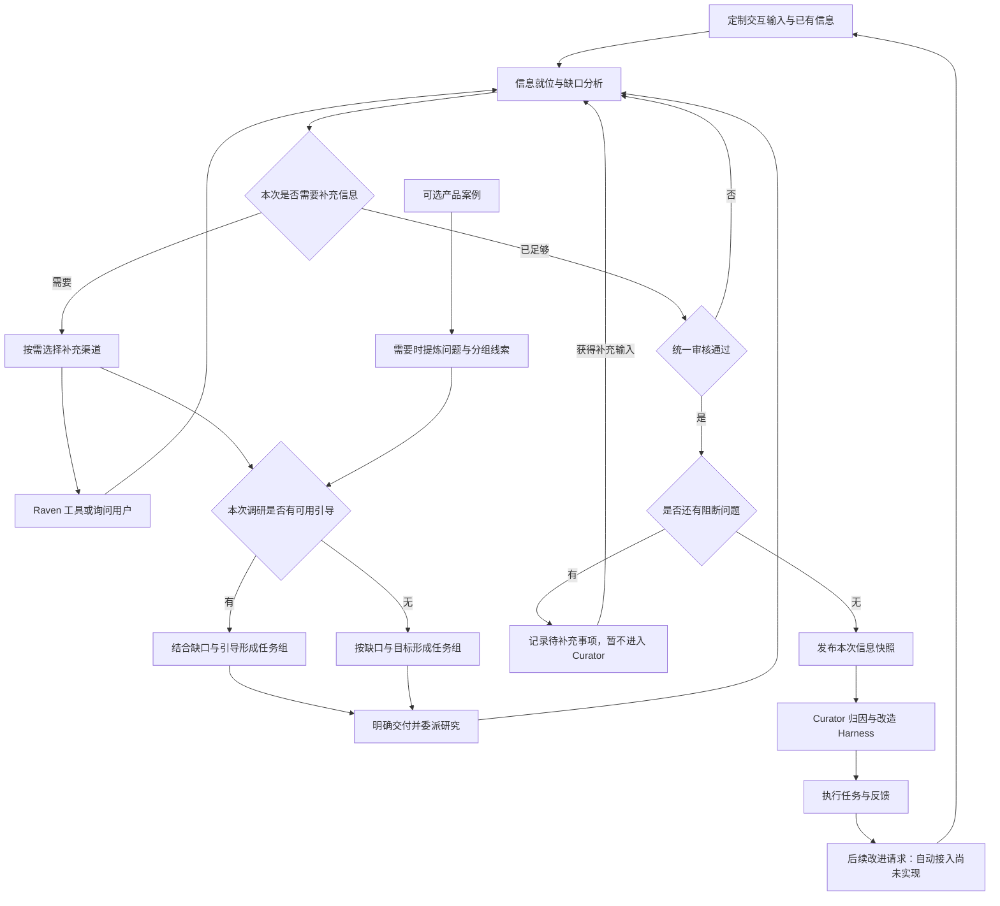

# 交互迭代改进 Harness：输入、边界、反馈链路与角色

本文是 2026-09-29 设计讨论的收敛结果，作为后续实现的依据。它只写已定的决策与待定项；机制的现状描述见 [rsi-iteration.md](rsi-iteration.md)，Curator 的结构见 [design.md](design.md)。

## 1. 目标

一个数字伙伴（模型加 harness）在与交互方的多轮交互中被改进，直到它在一般情况下满足交互方的要求。要达到的两种效果：

1. 自动化的培养过程与真人测试过程都有一个可观察、可评审的可视化入口（Studio）。
2. 真人可以通过同一入口直接驱动这个过程，替代模拟的工作对象与交互方；不替代批量挖掘的外层搜索。

## 2. 角色

| 角色 | 是谁 | 视角 |
|---|---|---|
| 伙伴 partner | 被培养的 worker | 自己的 home 与执行 |
| 工作对象 conversant | 伙伴干活时面对的人（客人） | 只见通道里的成品 |
| 交互方 counterpart | 持有资料与标准、评审并对 Curator 说话的人（老板） | 输出、交付物、声明的观察面、自己的资料与标准 |
| Analyst | 把外部判断翻译成内部可消费的要求 | 判断、会话、执行痕迹 |
| Curator | 机制归因与修正 | 要求、被引用的回合、机制活动、当前 harness、自己的历史 |

自动化分支只是把工作对象与交互方换成模型扮演；真人模式下由人充当这两个角色，管线不感知差别。

交互方的通用实现在 `experimental/cultivation/counterpart/`：`Owner` 是评审骨架（读会话与交付物、按案例注入的事实与画面评审、按披露日程交材料），`drills` 把题卡装成模拟对话人与并行分组的试炼，`case` 给成案判定提供交付谓词。一个案例（`simulation/agency.py` 的旅行社、`simulation/brand.py` 的品牌策略师）只注入自己的事实计算器，不复制装配。

## 3. 输入类别（封闭）

从闭环的参与者推出，场景输入只能描述参与者及其关系。加载器（`experimental/harness/scenario/`）要求场景目录里每个文件都属于一个类别。

| 类别 | 内容 |
|---|---|
| 起点 | 基线 harness、配置、模型 |
| 情境 | 岗位说明；题例（角色卡与抽值；带标准答案的题例另有期望） |
| 陈述 | 规范（交出的文档）与检查项（由规范派生的评审表，评价侧私有） |
| 资料 | 每件带种类：norm、fact、exemplar、counterexample |
| 约定 | 披露日程、交互方的可观察面、入职与交接话术 |
| 先验 | 往期培养记录 |
| 辅助 | 尺子的声明、记录标签（评价侧私有） |

尺子与模拟者的人设是自动化替身的配置，不是场景输入。

## 4. 可见边界

判定标准：**如果没有评测，只有真实使用，这条信息还会存在吗？** 存在的是合法反馈，不存在的是评测装置，不给 Curator。可见性按"谁产生"定：交互方主动说的可以到 Curator；评价机制推导的（检查项、逐项判定、期望答案、尺子、题库结构、隐藏人设）不到；伙伴内部的到 Curator 与 Analyst，不到工作对象；工作对象内部的只到交互方。

两个机制各管一半：信息边界挡装置；留出集让内容层面的泄露无用（题例每轮重抽数值，另有一组任何提示词都不碰的留出案例，价值判定只看它）。

执行点只有三处：装配（放进伙伴 home 与各模拟器的项）、听取（`hearing.py`，评价侧到 Curator 的唯一通道）、探索（`Withheld`，按路径屏蔽评测侧目录）。每个角色的真实模型输入跑扫描测试：检查项 id、题例 id、期望答案原文、尺子键、人设文本、场景目录名不得出现在伙伴与 Curator 的输入里。

生成环节的残余风险与对策：生成代码在伙伴进程内执行，员工的 shell 也在这个进程树里，文件访问靠进程级权限封住（4.2）；自然语言转述封不住，由留出集兜底。

### 4.1 边界在代码里的表达：受众声明、隔间与守卫

边界不靠提示词，也不靠在一处逐字段删除，而是三件事：

1. **字段受众声明。** 闭环上每个类型的每个字段声明它的受众（partner、conversant、counterpart、analyst、curator 的子集），契约里每一项声明可见性。比较过三种表达：每个角色一个视图类型（矩阵散在多处）、评价侧的值包成封印类型（挡不了嵌套字段）、字段级声明加通用投影（矩阵就在类型定义里）。采用第三种，角色、受众常量与投影在 `experimental/harness/participation/audience.py`，闭环与 Curator 的类型共用。`project(value, role)` 递归保留受众含该角色的字段；未声明受众的字段是错误。`hearing.heard` 即 `project(signal, "curator")`，`Remark` 类型退掉；Analyst 的材料是 `project(..., "analyst")`；交互方模拟器拿 `project(scenario, "counterpart")`。
2. **隔间。** 闭环按角色划成隔间（准备、装配、试炼、评审、分析、改造、记录），每一步在其隔间里执行。隔间是上下文管理器：设定当前角色与策略，`admit` 做投影并核验，`guard` 返回守卫后的 provider，进入与违规写进 `records/boundaries.jsonl`。
3. **守卫。** 信息进入一个模型角色只有三个咽喉：模型请求、文件访问、记录写入。守卫装在咽喉上，与内部代码路径无关。模型请求的守卫是 provider 代理，包住 `LLMProvider` 的全部抽象方法，请求发出前扫描消息与工具结果；文件访问的守卫是 `Withheld` 与 `confined`；记录写入带出处与受众。

守卫不判断语义，只知道来源与声明：

- 默认拒绝。进入隔间的值必须带"已为该角色投影"的标记，未标记的值拒绝。凡不能追溯到一个允许该角色的来源的信息，都不属于该隔间。
- 差分封印。对契约说该角色不能见的项，取 id、路径与文本的归一化滑窗片段做哈希集合，再减去该角色可见项的片段：只封印"只存在于被禁项里"的文本，这是可见性判定标准的计算版本，也避免检查项与规范文本重合造成的误报。封印集合由声明推出，不手工维护。入职与交接话术不封印：它们是交互方说出的话，说给 Curator 就被 Curator 听到，Curator 也可以转述给伙伴。滑窗按单位计重：一个汉字重 1，其他文字的一个词重 2，窗口重 20，约合二十个汉字或十个英文词。按字符等长切窗会让英文窗口只有三个词，角色用自己的话说出的普通短语（如 the itinerary template）也会被当成泄露。
- 尚未交出的材料只封照抄。分阶段交付时，信息收集（`research/scenario.py` 的 `release_guard`）还要封住后续才交的材料，但用 `Sealed.copying`：Curator 自己的封印（检查项、案例、它永远看不到的材料）仍按单窗口；尚未交出的材料要连续 `PASSAGE_SPAN`（10）个窗口都命中才算泄露，约合三十个汉字或二十个英文词，本身短于这个长度的材料仍按单窗口封。原因：从已交出的规范归纳出的一句话，可能碰巧与一份后续材料同序重合二十来个单位，单窗口会把它当泄露中止运行。前提是真正的泄露是成段照抄；后续材料里若有必须严防的短小事实（长材料中的一个数字、一个编号），这个做法不再适用。
- 按出处豁免。一个角色从有权说这些话的人那里听到的文本，不对它封印：工作对象描述自己的情况时会复述题卡，伙伴的回复又会复述工作对象的话，这些窗口都不是泄露。守卫在扫描前减去这部分（`Sealed.without`）：Analyst 与 Curator 的隔间减去截至本轮所有工作对象说过的话（Analyst 读整轮对话，交互方也可以引述其中任何一句）；伙伴的 provider 守卫减去请求里 user 消息的文本；模拟客人与模拟老板各在自己的隔间（conversant、counterpart）里调模型，减去伙伴自己的产出（回复、交付的文件、研究、同事报告、归档与后台操作），因为那是伙伴有权说给他们的，其余部分（人设、老板自己的标准与资料）按各自封印检查。豁免既按单条消息算，也按同一说话人的消息顺序拼接后算：一条消息只答一件事的客人，会被伙伴在确认时复述成一句，跨消息边界的窗口也是他说过的话；不同会话的客人从不拼在一起，两位客人各说半句封印文本仍然封印。一个被封窗口如果主体是说过的话、只多出不超过 `BESIDE`（5 个单位：几个汉字或两个英文词）的旁字，也一并豁免（`Sealed.without` 的 `_beside`，`Sealed` 为此留存被封文本的单位序列）：交互方引述客人原话时，题卡里引出这句话的舞台提示（如"开口说："）会和原话落进同一个窗口，引述说过的话不是泄露它旁边的几个字；题卡里成句的私有内容仍封存。Analyst 提交时的检查（`vet`）豁免的是改造时 Curator 隔间将豁免的同一组话。隔间进入后，为同一角色预先绑定的 provider（如 Analyst 的）改用这个隔间的守卫检查。系统提示、工具结果与伙伴自己的话里出现的封印窗口仍然算泄露，标识符永远封印。
- 转述抓不到，由留出集兜底；离线的模型审计只作证据，不进运行时。

策略只有两种：自动运行与测试用 abort，违规即中断并写记录；Studio 人工会话用 warn，人是交互方，它说的都合法，只提示。守卫工厂是可 pickle 的纯数据（角色、策略、封印哈希、记录路径），因为 Worker 的进程经管道收到 pickle 后的 `provider_factory`（`raven_adapter/launch.py`）。

新术语：受众 audience、投影 projection、隔间 compartment、封印 sealed。定义即本节，与 `iteration/compartment.py`、`scenario/` 的封印推导一一对应。

检查项的措辞规则（2026-10-07 品牌案例 run-1 的教训）：封印窗口只对可见材料里逐字出现的文本做差分，认不出翻译。检查项若是规范原句的英译，Curator 自己把同一句中文规范译成英文写进 docstring 时就会撞上封印窗口（10 个英文词逐字相同），运行被隔间中止。所以检查项要写成评价者自己的指令——指向规范的章节与算出的事实，不复述、不翻译规范原句。

### 4.2 进程级隔离：伙伴进程以专用用户运行

伙伴进程是 worker 子进程及其进程树：员工的 agent loop、它的 shell 与文件工具、子 harness 与产品子进程、Curator 生成并安装的策略代码。它们以 root 运行时读得到机器上的一切：场景目录（检查项、题卡、交互方持有的资料）、本运行的评价记录、别的运行、仓库与它的 `.git`。守卫只看模型请求，`confined` 与 `Withheld` 只管文件工具，挡不住 `exec` 里的 `cat`、`grep -r` 或生成代码里的 `open`。工具层的路径检查被所有者否决：拒绝一次就浪费一次模型输出，而且只挡它认得出的路径。所以改由操作系统挡。

| 方案 | 做法 | 在这台机器上 | 取舍 |
|---|---|---|---|
| A 专用用户与封闭布局（采用） | worker 进程以专用用户从代码镜像启动，只写自己的区域；评价侧只有 root 能读 | 容器有 CAP_SETUID、CAP_SETGID，实测可行 | 靠文件权限：个人区要对其他用户关闭；同一用户下同时进行的运行彼此只靠不可列举的目录名隔开 |
| B 每个 worker 一个命名空间或容器（bwrap、nsjail、unshare） | 挂载视图里只有镜像与区域 | 不可用：没有 CAP_SYS_ADMIN，unshare 被拒，没有 bwrap | 边界最干净 |
| C chroot | 把一整套用户态复制进监牢 | 有 CAP_SYS_CHROOT，但没有 bind mount，shell、coreutils、Python、证书、`/dev`、`/proc` 都要复制 | 重且脆；对这个威胁不比 A 多挡什么，系统文件不是秘密 |
| D 护栏：工具路径检查、安装前静态 I/O 检查 | 拒绝越界调用 | 可行 | 所有者否决（见上） |

A 成立的前提：机器上其他进程都以 root 运行，关掉 other 权限位只影响这个用户。有非 root 的人要读个人区，或要在同一目录下同时跑多个隔离运行时，A 要改为每个运行一个用户。

做法：

1. **区域。** `Worker(root, area=…)`：`root` 放闭环与 Curator 的记录、保留的交付物与准备好的资料，进程不读；`area` 是进程运行和写的地方：各代的根、assembly、保存的策略状态、子 harness 目录。`hire` 与 `replicate` 把区域放在 `<运行>/employee/` 与 `<运行>/replicas/<标签>/employee/`，home 与 deployment 也在里面。不给 `area` 时它就是 `root`，这样的 worker 不能隔离。读记录的代码按这个布局读；此前的运行用它记下的代码版本读。
2. **镜像。** 进程导入的代码按白名单复制：`raven/`、`agents/`、`plugins-dist/`，`experimental/` 只取 `audience`、`requirements`、`curator`、`scenario` 的代码与 `iteration/compartment.py`。场景、题卡、笔记、文档、测试、`.git` 都不在里面。环境由 uv 按锁文件同步（缓存里有的直接硬链接），解释器是复制出来的一份，这个用户能执行。镜像按内容摘要建一次，放在这个用户可读的目录（默认 `/opt/raven-worker`）。交给进程的基线里，指向仓库的路径都换成镜像里的同一路径（产品子进程的命令就是这样的路径）。父进程从区域往外复制（副本、校验副本、保存的状态）时把链接照原样复制、不跟随，只保留工作目录或区域里的交付物，所以进程放进区域的链接不会让 root 替它读出别处的文件。
3. **启动。** 进程由 subprocess 以这个用户（无附加组）启动，用镜像的解释器，环境只带白名单变量，HOME 与 TMPDIR 在区域里，参数经管道传。未隔离时同一个启动器用当前解释器与当前用户。
4. **交接。** 父进程的 umask 设为 077，它写的东西默认只有 root 能读；运行根目录 0711，可穿越、不可列举；每次启动与每次操作前，区域与工作目录里不属于这个用户的条目都交给它（父进程在两回合之间往 home 里放资料）。伙伴守卫的日志预先建成这个用户可写、不可读。
5. **检查。** 第一次启动前，以这个用户从镜像跑一次探针：必须能导入 worker 模块、能写区域；不能列出运行根目录、副本目录、运行所在的目录与系统临时目录，不能读运行根目录除区域外的任何条目，不能进入场景目录、仓库与命令行点名的路径；运行之上对其他用户可穿越、不可列举的目录都算所有者的私有目录，它们里面不在通往运行路径上的条目也必须关闭，第一个对其他用户可列举的目录为止。任何一条不满足就不启动，并列出路径。运行结束时运行根目录关成 0700。
6. **部署（一次）。** 建用户；个人区只留通往运行目录的穿越权，别处去掉 other 位。步骤见 `experimental/README.md`。

不防的：同一轮的演练副本同属一个用户，彼此只靠不透明的目录名隔开；进程自己产出的证据（观察记录、交付物）的完整性与以前一样，隔离管的是读，这个用户也能改写或截断边界日志；伙伴守卫随进程带着它的封印，其中标识符（检查项 id 等）与短于一个窗口的封印文本是明文，进程里的代码读得到；事后审计 `automation/isolation.py` 照旧是第二道。

## 5. 反馈链路与职责

本质链路：判断、行为归因、机制归因与修正。归因分两层，边界落在中间。

- Assessor 只判断输出，不知道 Curator 与 harness，不读 Curator 的计划。
- Analyst 做行为归因：合并、抽象为情境类、分级、复发判定、决定。写情境、行为、证据、验收、强度、复发；不写机制、不给处方。它看到机制活动只用于核对上一轮改动的声明，不用于归因。输出做结构检查：不得含检查项 id、题例 id、期望答案原文、target 名或策略面名。
- Analyst 的定位是评价侧的编辑：拥有交互方留下的标准（声明、派生、沉淀），接收交互方的话与各种判定，写出统一形式的要求与一个决定。它必要的理由只有一个：它是唯一看得到判定又产出 Curator 可安全阅读之物的角色；当判断以判定而非话的形式到来时（数据集、检查项、沉淀的回归检查），它是唯一的翻译者。派生的检查项进闭环，以判定形式、should 强度、交互方可否决；派生项的满意不单独终止运行。
- Curator 做机制归因与修正，只读 Analyst 引用的回合，会话键不透明。
- 预期（`Change.expected` / `verification`）写进记录，不进任何提示词：受众声明为只进记录，Curator 读到的上一版计划与历史、Analyst 读到的历史与子 Harness 计划都是按受众的投影；其价值由真实运行的命中率决定。
- Curator 的历史是每轮的（要求、诊断、改动、是否守住）四元组，不是自由文本：`iteration/history.py` 的 `Entry` 带要求（`Raised`）、诊断（`Diagnosed`）、改动（`Revised`，含处置与它针对的输入 `addresses`）与归因器身份，各字段声明受众，Curator 与 Analyst 读各自的投影；新一轮的诊断直接引用先前条目。
- "是否守住"只有一条规则（`iteration/ledger.py` 的 `held`）：下一轮沿用它 id 的要求、它依据的检查项或案例失败、以它 id 为名的条目（Standard 为它留的回归检查）失败，任一出现即没守住；这些条目有一条通过即守住；没有任何条目逐项衡量它时，Analyst 没再提它即算守住；条目都判"未知"说明下一轮没演练到它，与下一轮没有任何信号一样不下结论，所以没被检验的要求不会算作守住。Session 在下一轮分析之后把它写进上一条历史，台账（`ledger.rows`、`summary`）从历史读回，按归因器身份与（状态，处置）聚合。
- 留出集：`Session.holdout(trials, assessors)` 的会话与信号记进本轮的 `Round.holdout`、`holdout_signals`，不进 Analyst 的材料，也不会被引用给 Curator；台账的 `held_out` 按轮给出它们的判定，作为泛化的度量。留出的试炼必须在副本上跑、不在伙伴身上留下状态，否则它们的内容会经伙伴自己的状态到达 Curator。
- Curator 报告缺口（`report_gap`）时，本轮不改造，问题记进运行记录的 `questions`，运行继续；应答者在 Studio 里是人，自动运行里等调研阶段（C7）。

### 5.1 Curator 的归因与改造

改造之前先做机制归因，它是一个独立的步骤（5.1.3），不是理解阶段的一种形态：归因按每条输入产出一条诊断，之后的选择、设计、实现、修复只消费诊断，不再各自重新归因。

| 输入 | 归因做什么 | 产物 |
|---|---|---|
| `unmet`：已有预期没守住 | 证据回合、责任机制、失败类型、上一轮处理 | 诊断 |
| `met_but_rejected` | 机制起了作用但方式被否 | 诊断 |
| `new`：新要求 | 需要什么、缺失还是有而未暴露、触及哪些已有机制 | 诊断（常为 absent 或 not_exposed） |
| 新交的资料 | 内容落在哪、伙伴怎么读到 | 诊断带 `placement` |
| 路由给子 Harness 的节点要求 | 同上，由该作用域自己归因 | 诊断 |

状态用一个闭集：absent、not_exposed、not_triggered、not_consumed、wrong_logic、blocked、model_ignored、uncovered。机制在被引用的回合里先介入（拒绝、改写或回滚模型的动作）、失败是模型随后的做法时，介入是原因之一：拦下要求本身要的动作，就是该机制的 wrong_logic，不论它在别处拦对了多少（`attribution/prompts/diagnose.md` 与 `Diagnosis.state` 的字段说明）。起因是归因只问"哪个机制负责"时，会把 Curator 自己装的检查拦出来的失败记成新要求，下一次改造反而把检查再扩大。没有另设"由机制引起"的状态：wrong_logic 已能表达，新状态要动闭集、选择阶段与本文。这条说明的效果尚未经多轮运行验证。入职是所有输入都是 new 加资料的特例，没有任何输入时只诊断任务本身。选择的每个 target 必须以一条诊断为依据；`Plan.understanding` 只保留面向反馈者的解释；设计对每个改动写明是修改、替换还是新增诊断点名的机制。宿主校验的修复只处理代码，行为是否改善由下一轮回答。

### 5.1.1 诊断落在哪一层（2.9）

对方分支的生成阶段是 select、design、implement、repair，状态机在 `generation/run.py`。`Diagnosis` 落在哪一层，三个实质不同的方案：

| 方案 | 做法 | 代价与风险 |
|---|---|---|
| A. 诊断是选择提交的载荷 | `Selection` 加 `diagnoses` 与 `grounds`，解析时核对每条要求都有诊断、每个 target 至少引用一条 | 状态机不动；一次工具循环里既读证据又选面，模型可能急于选面而诊断浅 |
| B. 独立的归因步骤 | 归因有自己的提交、状态与记录，select 的材料带诊断 | 多一轮带查询的工具循环，成本最高 |
| C. 理解阶段里的第二个工具 | 在 select 循环里先调 `submit_diagnosis` 再 `submit_selection` | 要把单提交循环改成多提交；诊断与选择的顺序靠约定 |

采用 B（用户决定，2026-09-29）。B 落在哪里、和生成怎样分开，见 5.1.3。

产物：

```
Diagnosis
  about      要求 id（R3）、交出的资料（material:brand-design-guide）、路由的节点要求（node:work/step#1）或任务本身（task）
  state      absent | not_exposed | not_triggered | not_consumed | wrong_logic | blocked | model_ignored | uncovered
  mechanism  负责的现有机制：authored 值、文件或原生机制名；absent 时为空
  evidence   回合 id、记录种类、读过的来源
  earlier    此前哪一轮的哪个改动处理过它，没有则空
  placement  资料的安置：内容落在哪、伙伴怎么读到；只对资料
Attribution  每条输入一条诊断；about 不重复
Attributed   Attribution 加宿主的说明：做出它的归因器身份与它的记录名
Selection
  understanding  未决问题与选择理由
  targets        不变
  grounds        target 到 about 的映射；每个 target 至少一条，引用的 about 必须存在
Change
  treatment      modify | replace | add，对点名机制说明是改它、换它还是另起
```

核对：归因的提交 `submit_diagnosis` 必须覆盖 `subjects(feedback)` 给出的全部输入（要求 id、`material:<名>`、`node:<playbook>/<node>#<n>`，都没有时是 `task`），缺一即拒，多出的允许。`Declaration.parse_selection(value, attribution)` 核对每个 target 的 `grounds` 引用存在的 `about`；选择为空（保留现状）也要先有齐全的诊断。设计阶段的提交里 `treatment` 必填。

### 5.1.2 Analyst 输出契约（2.3）

`Requirement` 的新字段与受众：

| 字段 | 内容 | 受众 |
|---|---|---|
| `id` | 闭环分配，本次运行内顺序编号 `R1`、`R2`；Analyst 不写 | 全体 |
| `repeats` | Analyst 判断它重提了历史里哪条要求的 id；成立时沿用那个 id，`recurrence` 由此可算但先保留 | analyst、curator |
| `situation` | 行为应当出现的情境类，从 `behavior` 里拆出来；`behavior` 只剩期望的动作 | analyst、curator |
| `grounds` | 要求所依据的判定：`assessor:<名>`、`check:<id>`、`case:<id>` | counterpart、analyst |
| `materials` | 要求所依据的、已交出的资料名 | analyst、curator |

原设计写的 `sources`"经 hearing 递归剥离"，改为按受众拆成 `grounds` 与 `materials` 两个字段：字段级受众就是边界的表达方式，不必在 hearing 里再做逐项过滤。

结构检查在 Analyst 提交时做，模型可以重交：把提交投影到 curator 受众，用本轮信号自带的封印（条目 id、会话键、短于一个窗口的 `expected` 与 `note` 原文）加上运行的 `Boundaries` 里 Curator 的封印去扫，再查 target 名；命中即拒绝并说明。长的参考文本不在本地封印：要求会合法复述检查项所复述的规范，只有运行封印的差分（减去 Curator 可见的资料）分得清那段话是规范的还是检查项的。这与 `Session._curate` 的 `admit` 是同一套指纹，区别只在时机：提交时拒绝让模型改，改造时命中则中断。每条要求的 `evidence` 或 `observed` 必须点名本轮至少一个回合 id，否则 Curator 拿不到执行观察。

交接项类型化：`Signal.attachments` 由路径元组改为 `Handover(name, kind, files)`，`kind` 取契约的四种资料种类，`files` 是相对伙伴 home 的路径。模拟老板从契约读资料种类；`record.py` 与 `hearing` 按名字而不是路径识别资料。C3 由此才能按种类给 Curator 处理规则。

### 5.1.3 归因是独立的组件

需求（2026-09-29 复核）：

1. 归因相对独立、与生成解耦：有自己的输入、输出、版本、预算、检查点与记录，不寄生在生成的阶段机里。
2. 一般情况下归因与 Curator 是同一个模型：同一个 provider、同一个 model，是 Curator 对自己的 Harness 的推理，不是另一个角色。
3. 对齐现有需求：生成只消费归因结果，选择以诊断为依据，历史与记录保留诊断。
4. 向前兼容归因的迭代自我改进：换提示词、换模型、换输入范围、换实现（人审过的诊断、将来改进过的版本）都不改消费方，不同版本做出的诊断能比较。

先前落地的形态（记作 A）不满足 1 和 4：`diagnose` 是 `GenerationState.stage` 的首个值，归因与生成共用一份对话、一个预算、一个检查点，记录是 curation 记录的一部分；`Attributor` 只是两个参数，换一种实现没有入口，也不能对同一输入单独重跑归因。三个方案：

| 方案 | 做法 | 代价与风险 |
|---|---|---|
| A. 阶段参数化 | 归因留在生成阶段机里，版本由参数与提示词摘要表达 | 改动最小；不满足需求 1、4 |
| B. 独立组件 | `experimental/harness/curator/attribution/` 自成一包：`Attributor` 协议、自己的一次对话、预算、检查点与记录；生成从 select 开始，只接收 `Attributed` | 多一份对话前缀，归因的工具表与生成不同，提示词缓存前缀不共用 |
| C. 独立角色 | 与 Analyst 同级的第六个角色，自己的 provider 与隔间 | 违反需求 2；归因要读 Harness 源码、用原生探索工具，这些只在 Curator 侧，复制过去就是复制半个 Curator |

采用 B。成立的前提是：归因读的与生成读的是同一份上下文（任务、要求、引用回合、Harness 声明与源码），分开的只是它的对话与产物。若将来归因需要 Curator 看不到的信息，这个前提就不成立，那时要重新评估 C。

接口：

- `Attributor` 协议：`identity(model)`、`check(state, context, *, model)` 与 `attribute(context, provider, *, model, tool_registry, resume, progress) -> AttributionState`。`check` 在花费或丢弃任何东西之前判定一个暂停的归因能否续跑；`attribute` 返回的 trace 每行带 `event`，中途停下抛 `AttributionInterruptedError`（预算耗尽为 `AttributionPausedError`）并带上状态，报告缺口抛 `GapReportedError` 并把状态挂在其 `state` 上。不守这份协议的中断按普通错误结束本次改造，不当作可续跑的暂停。
- `ModelAttributor(model=None, catalogue=True, limits=AttributionLimits(), prompts=PROMPTS)`：`model` 为空时用 Curator 的模型。它在 Curator 的 provider 上开一次自己的对话，工具只有只读查询、原生探索、`submit_diagnosis` 与 `report_gap`，没有选择、设计、实现的提交，尾部带自己的剩余预算。`prompts` 是一个目录，含 `understand.md`、`diagnose.md`、`budget.md`，换一版提示词就是换一个目录。诊断把证据没能定下的部分写进 `uncertain`，而不是另造字段。与生成的各阶段共用一条规则：在最后一次调用上被拒的提交再给一次调用来改正，第二次被拒才算预算耗尽；这样提交格式上的一次失误不会让整轮调查白费（DeepSeek 上一次第 2 轮归因正是在第 8 次调用提交时多写了一个字段而暂停）。组合改造的共享预算因此可能超出一次，余量按零计，没有调用可用的作用域暂停。
- `SuppliedAttributor(attribution, by, origin)`：别处做出的诊断，例如人在 Studio 上审过的，只核对覆盖。`SuppliedAttributor.of(value)` 接受 `Attribution` 或 `attribute()` 返回的 `Attributed`，后者的身份与记录名成为 `origin`，所以人审过的版本仍能与它出自的那一版对照。
- 身份：实现、模型、是否带 target 目录，以及一个摘要，覆盖请求写成所依据的全部文本：归因自己的提示词、Curator 共用的规则与请求框架（`render.prompt_files()`），以及提交与缺口工具的描述与模式；模型取请求实际使用的那个，未指定时取 provider 的默认模型。身份不含预算，暂停的归因可以用更大的预算续跑。续跑要求身份与输入指纹（`input_id`）都不变，否则拒绝，且拒绝时检查点与探索工作区原样保留。`input_key` 只由输入决定（不含本次改造新建的工作区路径与归因器身份），同一输入由两个版本各归因一次时二者相同。
- 记录：每次归因写 `<worker>/attribution/<uuid>.json`，无论它怎样结束，都含身份、反馈、被诊断的 Harness 版本（`revision`）、`subjects`、`input_key`、`input_id`，能取得时还有调用与查询次数、请求的前四条消息与 trace，以及诊断、暂停原因或错误之一。curation 记录只写它的名字与身份（`attribution`、`attributor`），`Round.attribution` 列出本轮的归因记录。组合改造时每个作用域各自归因、各用一份归因预算；每个作用域的归因记录（成功或失败）都复制到 worker 顶层，组合的 curation 记录写根作用域的那一份，并在 `budget.attribution` 里汇总各作用域归因的调用与查询次数。
- 检查点：归因暂停时，`curation/pending.json` 存 `attribution_state`，下一次 `improve` 或 `attribute` 从这里续；生成暂停时存 `state`，其中带已接受的 `Attributed`，续跑不重做归因；若调用方给了另一份诊断或另一个归因器（身份不同），拒绝续跑生成，`resume=False` 才丢弃它。
- 单独入口：`workflow.attribute(worker, provider, feedback=…, observations=…, attributor=…)` 只归因，只写归因记录；用于同一输入在不同版本上各跑一次，或让人先审诊断再交给 `improve(attribution=…)`。组合 worker 上它归因根作用域，看到的与组合改造时的根作用域相同，检查点放在 `curation/attribution-scope/`，不碰进行中的组合改造。
- 生成：`generate(context, provider, attribution=…, investigation=…)` 从 select 开始；归因读过的证据作为 trace 的开头，进入后续阶段的历史。
- 闭环：`improve`、`propose`、组合、`Session`、`run()` 都传 `attributor` 与 `attribution`；模拟入口的 `--model attribution=…`、`--effort attribution=…`、`--attribution-catalogue`、`--attribution-prompts`、`--attribution-calls`、`--attribution-queries` 写进运行设置。

向前兼容指的是哪些用法要配合：将来的"归因迭代改进"会产生新版本的提示词或新的 `Attributor` 实现，它们要能在不改选择、历史、记录与台账的前提下接进闭环，并与旧版本的诊断放在一起比较。为此：新版本经 `--attribution-prompts` 或 `run(attributor=…)` 注入；每条诊断带身份，台账按身份分组；每次归因的输入与过程都在记录里，可以离线复评；`attribute()` 让同一输入在不同版本上各跑一次。旧版本的暂停状态不跨版本续跑，这是有意的。

度量（台账 2.8 实现）：

- 覆盖：`subjects` 里每项都有诊断，由解析保证。
- 守住率：一条要求的诊断状态为 X、改动处置为 Y，下一轮它是否被 `repeats`，或它所依据的检查项是否转为 pass。按身份与（状态，处置）聚合，身份之间比较。
- 修复错误按点名机制归类：实现阶段的校验错误落在诊断点名的 `mechanism` 上，说明归因对了位置而设计或实现错；落在别处说明归因偏。
- 成本：归因的调用与查询次数，按身份聚合。

前提与限制：一次运行内所有改造用同一个归因器，版本比较靠跨运行按身份分组，不在一次运行里 A/B。诊断的对错只有事后信号，没有金标，量小时只能看趋势。让 Curator 自己去改归因的提示词是第二层递归，本次不做；开始它的条件是台账里每个身份都有足够的轮次，并有留出集与人的验收。

## 5.2 反馈的其他来源：评价侧的 Standard

闭环接受任意多个 Assessor，反馈空缺时只要有一个带标准的自动 Assessor，loop 仍能转。标准只有三个合法来源，合成评价侧的一个 `Standard` 对象，每条带来源、强度、出处：

| 来源 | 内容 | 强度 |
|---|---|---|
| 声明的 | 场景手写的检查项 | must_hold |
| 派生的 | 从交出的规范文档抽出的可检查条目 | should，交互方确认后升级 |
| 沉淀的 | 交互方历史上提过的每条要求，作为常驻回归检查 | 沿用要求自己的强度（must_hold 或 should） |

叠加规则：交互方优先，派生的只填空缺；关闭即不装该 Assessor。派生标准只从规范抽，不从范例、不从伙伴自己的输出抽；它是评测装置，不给 Curator。派生标准的满意不能单独终止运行。沉淀的来源价值最高：交互方沉默时 loop 至少在守已确认过的东西。

实现在 `experimental/harness/assessor/standard.py`：

- `Criterion` 带 id、文本、来源、强度、出处，以及适用情境与验收；`Standard` 按来源组合，id 跨来源唯一。`Standard.declared` 取场景检查项；`sedimented(history)` 把历史里每条要求（按 Analyst 的投影读）变成回归检查，同一 id 取最新措辞；`confirmed(ids)` 是交互方确认后把派生条目升为 must_hold。派生条目另带 `quote`，即它所依据的规范原文。
- 派生条目由 rubric 构建者（`experimental/harness/assessor/builder.py`）从规范写出、由元评审者（`experimental/harness/assessor/reviewer.py`）在宿主授权的范围内逐轮修订；此前的标准评审者（critic）已被这一机制取代（2026-10-09 合并）。
- 引文核对比的是字，不是写法（`critic.py` 的 `_flat`）：两边都先做 NFKC，把所有引号（单双、直弯、直角）当作同一个，并去掉 Markdown 标记（加粗与斜体的星号、行内代码、表格竖线，行首的列表、标题、引用标记与复选框）；漏抄的文字仍拒。模型抄规范时常换引号写法、丢掉加粗与复选框，逐字符比对会拒掉正确的引文并计次。给 critic 看的规范把每行的直双引号换成成对弯引号（`_shown`）：引文要抄进 JSON 字符串，直双引号得转义，模型漏了转义时每次提交都在引号处断开；弯引号不用转义，核对又把所有引号当作同一个，有据校验不变。前提是断开只因要抄进 JSON 的直双引号；模型若在别的字符上也这样断，这个做法不够。
- `StandardAssessor` 按标准逐条判定一轮的会话（对话原文加交付的文本文件），结果作为 `Signal` 的条目交给 Analyst 翻译，自己不说话。满意只看被演练到的 must_hold 条目，没有就不下结论，所以派生条目的满意不会单独终止运行。
- 闭环在每次评价前把历史交给带标准的 Assessor（`sediment`，`iteration.session.assess` 按有无这个方法调用），不改 Assessor 协议。它的模型调用在 Analyst 的隔间里跑，豁免本轮用户的话与它持有的沉淀、派生条目；声明条目是检查项，契约可能对 Analyst 封住它，所以模拟入口只取对 Analyst 可见的检查项，隔间也从不豁免声明条目。它与模拟老板同属评价侧，模型与推理强度取 `--simulation-model` 与 `--simulation-effort`：推理模型在高强度下可能把整个输出预算花在思考上、交不出评分卡，`exchange` 的 trace 在缺输出时记下结束原因与用量，以便看出这一点。
- 模拟入口 `--standard declared derived sedimented` 按需选来源，与模拟老板并列；标准与调用 trace 在每次评价后写进运行目录的 `standard.json`（`StandardAssessor` 的 `keep`），在两轮之间被停下的运行也保有至此的每版修订与判定。

### 5.2.1 反馈的内部来源：伙伴自评（source = self）

外部信号（交互方的话、Standard 的判定）看到的是交付物与最终回复；还有一个来源是伙伴自己对同一批产出的复查，它衡量的是 Harness 的自知：哪些缺陷它自己看得出、哪些看不出。实现在 `experimental/harness/assessor/introspect.py`：

- 每轮演练结束后，在伙伴的**副本**上（与留出集同法，不在本体留状态）为每单开一个新会话，给它看这单的对话原文与交付的文件，要它逐单给出判定（`VERDICT`）、缺陷清单（`DEFECTS`）与一句说明（`NOTE`）。它只看自己的产出，不看任何标准、检查项或交互方的话，所以没有标准泄露。
- 结果是一个 `Signal`，`source` 为 `self`：`text` 是伙伴自己的话（按 `HEARD` 投影可达 Curator，会话以不透明标签指代），逐单 `Item`（`self-review:<标签>`，`actual` 为缺陷清单）按 `EVALUATION` 只到 Analyst；`satisfied` 恒为 None，自评永不终止运行。原始复查记进运行目录 `analysis/<id>.json`。
- Analyst 把自评与外部判定对照：伙伴自己没发现、外部判了失败的缺陷是盲区，写成"自检"类要求；伙伴自己发现了却仍然交出去的，写成执行层的要求。Analyst 不把外部标准的措辞借给自评。
- 成案判定里它只作参考（自评与外部判定的一致率跨轮变化），不否决。模拟入口默认开启，`--no-introspection` 关闭。

## 5.3 信息准备：替换旧场景补充编排

目标是让任务驱动的信息收集承担同一个职责：在一次 Curator 调用前，判断已有内容是否足以支持当前目标，按需补充，并交付经过审核的信息。缺口、补充方式和研究分组由 LLM 判断；程序负责输入范围、引用、预算、版本与交付门槛。

**状态：共享信息准备已接入独立专家入口、离线入口与 Scenario 首轮。** 旧的类别缺口判断、固定归纳/确认编排和场景打包已删除。后续轮次不自动收集。详细责任映射、调用方、替换顺序与验收见 [信息收集替换设计](expert-information-plan.md#replacement-design-one-information-preparation-responsibility)。

### 5.3.1 挖出的旧设计与实际实现

旧设计已经提出“补足 Curator 的输入”，并计划以后响应 Analyst 的 `supplement`/`clarify` 与 Curator 的 `report_gap`。与本次工作解决的是同一类任务。旧实现的具体链路是：

`Scenario → slots 分类规则 → 按类别触发 induce / inquire → counterpart 逐条决定 → package 写出新 Scenario → loop 加载`。

旧实现中，已删除的 `slots.py` 根据材料是否存在决定可归纳、可研究或只能问交互方；`induction.py` 将实例归纳为规范；`inquiry.py` 研究事实或行业做法并核验引文；`confirm.py` 记录交互方采纳、修正、驳回或未决；`package.py` 把产物写成规范/事实材料并调整交付计划。这解释了它为什么只覆盖了完整专家信息准备的一部分。

旧设计的未来入口尚未接通：Analyst 的补充/澄清决定不会自动启动调研；Curator 的缺口只会结束当前改造并留下问题。不能把这些已有标记误认为已有完整的补充调度。

### 5.3.2 替换边界与新接入位置

- **替换编排**：取消 `slots` 的规则缺口判断及其驱动的固定归纳、研究、确认链。统一由收集 LLM 评估内容并选择补充；理解案例成为其正常推理，不增加固定的归纳阶段。
- **复用能力**：继续使用 Raven 原生工具、研究执行器、网页读取与引用核验；将其中与 Scenario 特定语义耦合的部分交给输入适配。八个维度不要求八种研究结果或八个代理。
- **保留不同职责**：交互方采纳不能被内容审核替代；Scenario 仍定义演练、可见性和披露；Curator 仍诊断实际 Harness。信息充分不等于机制已经实现，也不自动生成评价标准。
- **改变交付物**：离线准备输出版本化的信息结果与记录，不再默认改写场景目录和披露计划。Scenario 首轮与独立专家入口调用同一信息准备接口；现有 `collect_for_curator` / `handover_information` 是收敛位置，底层每个 `improve` / 子 Harness 不重复启动收集。
- **保留可复现实验**：从“整个 loop 必须不知道调研”改为“每次 Curator 调用绑定冻结输入”。记录场景摘要、实际已交付材料、信息版本与 Curator 配置；匹配的已审核离线结果可以复用，输入不符则重新评估。
- **范围限定**：此次迁移只接通初次构建/入职。后续 Analyst 决定、用户新材料、Curator 问题可转换为同一请求，但自动轮间调研、权限变更、暂停后的自动重启均不实现。

Scenario 适配必须从本次已交付且允许接收的信息构造输入；`Scenario.handed` 仅表示允许交付，不能代替已交付集合。离线入口也必须声明准备的交付范围，不能用未来轮次材料准备的信息冒充首轮输入。只用于调研引导的案例不进入交互材料集合。

### 5.3.3 专家信息收集：按材料用途组织补充任务

`research.information` 定义八个输出维度：专业定位与边界、任务与情境、知识、能力、方法与规范、经验判断、案例、表现与学习；资源单列工具及运行前提。字段用于交付和覆盖审核，不代表八个独立调研任务。

材料按本次用途处理：

- **交互输入**：任务、反馈和提供的材料直接参与就位与缺口分析。产品包以这种方式提供时，也不强制先抽象或重新调研；已有内容的相关性、适用性与证据仍须审核。
- **可选调研引导**：只服务于调研环节。产品案例由独立的只读工作区提炼为研究问题、关系与分组线索，不成为专家已经就位的知识。没有这些案例，仍按缺口和目标研究；有案例也不代表必须研究。



`research.collection.collect_information` 运行一个收集 agent 和单独的审核交换。agent 自主选择原生工具、研究组或用户提问。`ResearchTask` 在规划层关联维度、已知证据与是否使用引导，并承载 `ResearchBrief`：背景、已有信息、问题、范围、交付和验收。宿主先检查维度范围和证据引用，再形成 `ResearchAssignment`；研究会话只接收语义任务书。收集者可看到组数上限与剩余容量，不固定按字段启动。每次委派经 `research.review` 做一次来源核验和受限模型审核。审核拒绝返回收集 agent，由它决定是否携带 `previous_attempt` 修订或改用其他渠道；内部不自动重试。只有通过的内容进入证据，多包再由整体描述审核检查覆盖、重复与分歧。整次收集受总时限约束，未完成时保留快照、证据及停止原因，不交付 Curator。

`research.curator.collect_for_curator` 的 `materials` 是交互输入，`research_references` 仅供可选引导。后者不加入收集者的材料来源；需要研究时才通过 `research.guidance` 在独立工作区读取并提炼，一次结果可供多个组使用。收集者先调用 `prepare_research` 获取引导，再确定任务组并委派；使用尚未读取的引导会被拒绝，和上图一致。已准备的 `Request.guidance` 可直接复用。可选引导提炼失败会记录原因，研究仍可针对原问题进行。两条分支共享相同的研究提交、引用核对与最终审核。

Raven 的 `Exploration` 继续管理原生文件工具、shell 供给、源码快照和权限。交互材料可以直接支撑内容；引导只有问题，不在知识证据登记中占据条目。来源真实性、结论支持、组织采纳和实际能力表现分别判断，不能以文件存在、引文匹配或产品声明替代。

向前兼容落实为以下契约，而非现在接入每轮调研：

- `Request.previous` 接收既有 `Snapshot`；`focus` 决定本次关注的字段，非关注字段及未决问题必须保留。
- `Request.answers` 按已有问题 ID 提供用户答复，`answers_version` 必须匹配上一快照；答复限于本次关注范围，作为新的用户证据交给 agent，避免重复提问。
- 研究组可跨多个关注字段，复用 `known_evidence`；新提问使用唯一 ID；采纳问题包含提案原文，回答关联该问题与记录中的信息版本。
- `Result` 给出上一快照 identity、本次 `changed_dimensions`、资源与问题变化、新快照及绑定版本的审核结果。新快照另存为 `snapshot.json`，引导另存为 `guidance/guidance.json`。
- 已发布信息存在时，收集必须使用匹配的前一快照。发布时再次核对基线版本和内容摘要；通过 Curator 的 `unfinished` 接口检查本地、复合与下属作用域检查点，暂停期间不替换输入；发布日志支持内容和版本写入中断后的恢复。
- 后续接入方仍负责调用时机和可见性投影。自动轮间调用、`report_gap` 应答调度与暂停生成后的重启未实现。

`simulation.experts` 在首次 `improve` 前调用这条链；Scenario 通过 `Session.prepare` 在首次入职改造前调用同一流程。业务任务可独立提供，交互材料和调研参考均按各自用途可选。后续工作请求不自动再次收集。只有审核接受且没有阻断问题才交付 Curator，信息充分性不代替 Curator 的机制归因。

离线输出 `result.json` 可用于复用，`information/snapshot.json` 可用于重新评估和聚焦补充。复用要求任务、实际交付材料、上下文和环境一致，且审核版本匹配；否则在调用模型前拒绝。信息清单采用内容摘要，不把临时探索路径当作资源依赖。首轮交付把信息版本作为明确的归因输入，运行记录中也展示准备结果。

审核始终看到实际获得的工具/研究证据和用户回答，即使候选描述没有引用它们。交互方采纳通过询问表达，提案原文保留在问题里；模拟交互方的私有来源不进入收集上下文。信息审核通过不自动改写 Scenario 的规范或评估标准。

本地测试使用受控模型响应验证分支、渠道、跨字段研究、材料隔离、版本保护、用户问题与首轮接入。它们不能证明真实模型的调研完整性或语义审核准确性；真实 LLM 和实际专家工作效果须另行验证。

### 5.3.4 对照演示路径的验证评审

本次替换已完成。初次验收的 260 项相关测试通过；静态检查、类型检查、入口帮助、源码语言与大文件检查通过。这轮验收使用受控模型响应和文件/子进程场景。后续另用三个 GTM 专家包案例进行了 DeepSeek 主流程与 Claude Code 调研的真实比较，修复来源标识与预算失败解析后，相关测试增至 262 项通过。真实测试的参数、限制和待完善项见 [实施记录](expert-information-plan.md#live-information-preparation-validation)；两轮验证均不代表专家业务效果已达标。

| 演示路径 | 已检查的实际行为 |
|---|---|
| 已有信息充分 | 可以不调用工具、调研或案例提炼，审核后交付 |
| 本地工具补充 | 文件和子进程结果进入证据；受保护来源被修改时结果失效 |
| 无案例引导的调研 | 按问题组织跨维度任务组，复用已有依据 |
| 有案例引导的调研 | 先读取引导再形成组；原始案例不会重新进入 Curator 的普通来源 |
| 等待用户补充 | 问题不丢失；阻断时不改造、不演练；答复须绑定上一快照版本 |
| 审核退回修订 | 保留全部用户约束，并先确认上一条工具提交，保证后续模型对话完整 |
| 后续改进 | 携带已发布版本进入 Curator；不会自动重新启动收集 |

另外覆盖了离线结果复用、输入或回答变化后的拒绝、单层与复合暂停保护、历史废弃检查点不误拦、发布中断恢复、采纳与审核分离，以及运行记录展示。详细执行命令与迁移决策见 [实施记录](expert-information-plan.md#final-verification)。

## 5.4 有界交换，回合与运行怎样结束

评价侧、模拟侧与信息收集里的模型调用（交互方评审、critic、标准评判、Analyst、模拟工作对象、收集各阶段等）都经 `iteration/exchange.py` 的 `exchange`：可以查询，必须以一次结构化提交结束，调用次数有上限。Curator 的归因与生成另有自己的循环（5.1.3）。

- 最后一次调用只开放提交工具；模型仍点名查询工具时拒绝且不执行。否则爱查询的模型会把最后一次也用在查询上，阶段以次数耗尽结束。
- 宽限（`grace`，默认 2；Analyst 的 `Limits.grace` 同为 2）：没送达的回复重试且不计次。"没送达"只指模型想说的内容没有到达：没有工具调用、在只能提交的最后一次调用上查询、参数无法解析，或参数不符合工具声明的形状（缺字段、多字段、JSON 类型错，`SHAPE_ERRORS`）。形状合法、被长度、范围、枚举或校验器拒绝的值是模型说出的内容，照常计次，次数上限对它说过的一切仍然有效。起因是一次没送达的回复（如把字段名写错一个字母）就能结束整个阶段乃至整个运行。
- 回复正文放回对话前截到 `ECHOED_CHARS`（4000 字），工具调用整条保留（`render.assistant_message`）。交换循环记 `output.capped`，Curator 生成循环的 `model.note` 同样截断并记原长，两处共用这一条规则。起因：模型偶尔在正文里重复几 MB 的工具调用标记，原样回传会让下一次请求超过网关的请求体上限。

回合的结束：一个回合超过单回合时限，或模型没有给出回答（Raven 以 `AnswerlessTurnError` 结束回合，worker 的 `trial_turn` 把它记为回合结果 `answerless`，不当作 worker 的故障），对话保留这一回合并结束，评估方看到"没有回复"及原因（`Exchange.stopped`，超时与无回答共用这一处），由评价去判断。进程崩溃、越界等基础设施错误照旧中止运行。候选机制在回合内抛出的其他异常仍会结束整个运行，这是记录在案的折中，见 [实施规划](cultivation-loop-plan.md) 第 8 节。

运行的结束（`iteration/run.py`）：记录的状态是 finished、paused（一次改造被中断、可续跑）、stopped 或 error。运行被外部取消（花费上限的看门狗、人手动停）时记 stopped 与原因再退出，不再一直写着 running；页面把 stopped 与 finished 分开显示。

## 6. 管线契约的改动

- `Signal.attachments` 改为带类别与条目 id 的交接项；检查项到规范的映射只在评价侧。
- `Requirement` 加闭环分配的 `id`、`repeats`、情境字段 `situation`，以及按受众拆开的 `grounds`（评价侧）与 `materials`（Curator 可见）。
- 给 Curator 的会话一律用不透明标签（`hearing.opaque`，按试炼名的短哈希，同一试炼跨轮不变）：引用回合、机制活动行、历史里的活动行、伙伴的会话键与演练副本的目录名都用它，因为副本路径与会话键会出现在 Curator 读到的执行记录里；执行观察只含 Analyst 在要求的证据或观察里点名的回合（`hearing.cited`）。演练副本沿用伙伴的 provider 工厂，所以每次演练都在伙伴的守卫之后。
- 记录写入时打 `origin` 标签，台账按标签连接：标签即类型化历史里的 id（要求 id、`grounds`、`addresses`、诊断的 `about`），不另设 origin 字段。
- 披露日程是由契约推出的输入对象 `scenario.Disclosure`：运行选定 `all`、`staged`、契约里的具名计划或显式分批，它给出开场交什么、第 k 次评审交什么、交互方是否自选，以及最后一轮前交齐。日程归交互方，模拟老板与 Studio 里的人按同一条规则交出；闭环不读日程，只搬运交出的东西（`Signal.attachments`），运行设置记下解析后的日程。执行观察对 Curator 的范围是 Analyst 引用的回合（`hearing.cited`，取舍见 4.2）。
- 先验经 hearing 过滤后才到 Curator：往期培养的历史按 Curator 受众投影、以不透明标签（`prior-N`）作为反馈的 `prior` 进入每次改造，评分、判定、会话名与路径都不过去。先验不整体豁免：会话打开时用本运行的 Curator 封印扫一遍它的投影，只豁免原运行里工作对象说过的话（原运行的 Curator 隔间也只豁免这些），命中就拒绝打开；这样换了契约或手写的记录都不能把本运行封印的文字带进来。它是别的伙伴在别的 harness 下的经验，提示词要求据此识别守住与没守住的处置，而对本伙伴的诊断仍以它自己的代码与观察为准。

## 7. 分阶段

第一阶段（已完成）：场景契约与加载器、可分步的 `Session`、快照契约测试、文档。

第二阶段（已从 Curator 分支尖 rebase，进行中）：`run()` 改写为 Session 的自动编排（已完成）；hearing 的扩展（投影、引用回合、不透明会话键已完成，先验过滤等 C4）；`Withheld` 路径模式（已完成）；`simulation/scenario.py` 消费契约；通用机制（雇佣、副本、并行、约束、交接、运行设置）上提；留出集与 `origin` 标签、通用台账；模拟老板不再读 Curator 计划。

第三阶段：Studio 服务端接 Session，`live.ts` 由回放改为轮询记录加 pending 状态。

评价侧 `Standard` 与自动 Assessor、旧槽位驱动的归纳/研究均已有实现。信息准备已按 5.3 迁移到共享收集流程；只接通首轮，后续轮次保留请求契约而不自动调度。

四策略面收口与本文正交：输入侧五类，输出侧四面，先做输入侧。

## 8. 待定与待验证

- Curator 全量观察里子 harness 的上下文是否夹带交出文件以外的内容（在真实记录上核）。
- 五类对第二个领域是否穷尽；有状态环境作为工作对象时是否需要子项。
- 模拟者配置（人设、语气）放在场景目录还是自动化层。
- 先验进 Curator 的形式。
- 预期字段的命中率，决定是否给任何角色看。
